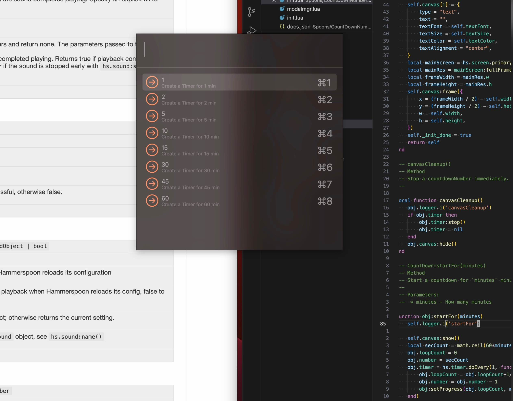
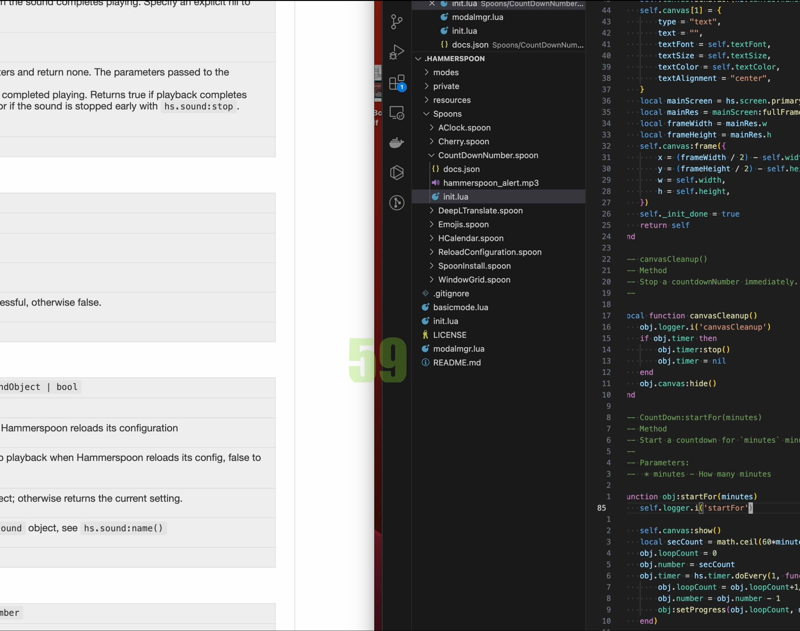

# Hammerspoon Modal Manager
[](https://opensource.org/licenses/MIT)

A keyboard-driven macOS toolkit built on [Hammerspoon](http://www.hammerspoon.org/). Like Vim, it uses modes: enter one, and plain keys take on a new job until you leave it.

## Overview

- Window management with single-key commands
- Application launcher with your own shortcuts
- Desktop widgets: clock, Space number and calendar
- Clipboard viewer
- Mouse control from the keyboard
- Moving windows between Spaces and monitors
- Countdown and Pomodoro timers
- DeepL translation
- Works alongside [yabai](#using-with-yabai)

## Core Concepts

### Modal System

Everything starts from the **Modal Manager**, which is on when Hammerspoon launches. Press `Alt + M` to turn it and all of the shortcuts below off or on. (`Alt + Space` is the default if `modalmgr_keys` is not set.)

While it is on, these keys enter a mode:

| Key | Mode | Purpose |
|-----|------|---------|
| `Alt + A` | App Mode | Launch applications |
| `Alt + R` | Resize Mode | Resize and position windows |
| `Alt + V` | View Mode | Scroll and move the mouse from the keyboard |
| `Alt + C` | Clipboard Mode | Show what is on the clipboard |
| `Alt + S` | Cheatsheet Mode | List the menu shortcuts of the frontmost app |

The current mode is shown in the bottom right corner of the screen. In every mode, `Q` or `Escape` exits. In App, Resize and View Mode, `Tab` shows or hides the list of available keys.

## Installation

1. Install [Hammerspoon](http://www.hammerspoon.org/) and give it Accessibility permission when asked.
2. Clone this repository, including its submodule:
   ```
   git clone --recurse-submodules https://github.com/zzuse/hammerspoon.git ~/.hammerspoon
   ```
3. Launch Hammerspoon, or reload its configuration from the menu bar icon.

Spoons that are not in this repository, such as Emojis, are downloaded by SpoonInstall on first launch.

## Updating

```
cd ~/.hammerspoon && git pull --recurse-submodules
```

## Key Features

### Window Management (Resize Mode)

Press `Alt + R`, then:

| Key | Function |
|-----|----------|
| `F` | Fill the screen (keeps the menu bar and Dock visible) |
| `C` | Center the window |
| `Shift + C` | Resize and center |
| `H` | Left half of the screen |
| `J` | Bottom half of the screen |
| `K` | Top half of the screen |
| `L` | Right half of the screen |
| `Y` | Top left corner |
| `O` | Top right corner |
| `N` | Bottom left corner |
| `M` | Bottom right corner |
| `=` | Grow in all directions |
| `-` | Shrink in all directions |
| `Shift + O` | Make wider |
| `Shift + Y` | Make narrower |
| `Shift + M` | Make taller |
| `Shift + I` | Make shorter |
| `Shift + H/J/K/L` | Move the window left/down/up/right |
| `[` / `]` | Focus the previous/next window |
| Arrow keys | Move to the monitor in that direction |
| `Space` | Move to the next monitor |
| `Q` or `Escape` | Exit |

All of these work on whichever monitor the window is on, and growing a window stops at the edge of that monitor. A window moved to another monitor keeps its proportions, so a left half stays a left half.

### Mouse Control (View Mode)

Press `Alt + V`, then:

| Key | Function |
|-----|----------|
| `H/J/K/L` | Scroll left/down/up/right |
| `Ctrl + H/J/K/L` | Move the mouse 50px |
| `Shift + H/J/K/L` | Move the mouse 10px |
| `Ctrl+Shift + H/J/K/L` | Move the mouse 1px |
| `,` | Left click |
| `.` | Right click |
| `Q` or `Escape` | Exit |

### Application Launcher (App Mode)

The mode I use every day. Press `Alt + A`, then a shortcut:

| Default Key | Application |
|-------------|-------------|
| `f` | Finder |
| `s` | Safari |
| `t` | Terminal |
| `v` | Activity Monitor |
| `y` | System Settings |

To use your own list, set `applist` in `private/awesomeconfig.lua`. It replaces these defaults.

### Clipboard Viewer (Clipboard Mode)

`Alt + C` acts on the current clipboard contents:

- **Image** - shown in the center of the screen
- **Link** - opened in your default browser
- **Text** - shown in large type across the screen

Click the image or text to close it.

### Desktop Widgets

- **Digital Clock** - A dim green clock in the top left corner of every Space, even in game mode.
- **Space Number** - The current Space number in the top right corner of the primary display.
- **Caffeinator** - A menu bar icon that keeps the Mac awake. Click it to turn this on or off.

### Global Shortcuts

These work whenever the Modal Manager is on.

| Key | Function |
|-----|----------|
| `Alt + M` | Toggle the Modal Manager |
| `Alt + Z` | Toggle the Hammerspoon console |
| `Alt + I` | Window hints (label each window, then press its letter) |
| `Alt + G` | Window grid |
| `Alt + E` | Emoji picker |
| `Alt + T` | Start a countdown timer |
| `Alt + P` | Pause or resume the countdown timer |
| `Shift+Alt + 1` | Move the window one Space left |
| `Shift+Alt + 2` | Move the window to the next monitor |
| `Shift+Alt + 3` | Move the window one Space right |
| `Ctrl+Alt+Cmd + T` | Toggle the digital clock |
| `Ctrl+Alt+Cmd + D` | Translate the selected text with DeepL |
| `Ctrl+Alt+Cmd + S` | Start a Pomodoro timer |
| `Ctrl+Alt+Cmd + P` | Pause the Pomodoro timer |
| `Ctrl+Alt+Cmd + R` | Resume the Pomodoro timer |
| `Ctrl+Shift + E` | Send `exit` to Terminal |
| `Ctrl+Shift + H` | Hide the files on the Desktop |
| `Cmd+Ctrl+Shift + H` | Show the files on the Desktop again |

## Using with yabai

Hammerspoon only moves windows when you press a key, so the two can run together. If you bind yabai commands with skhd, check that those keys do not overlap with the shortcuts above. yabai still has the final say over the windows it tiles:

| | Tiled window | Floating window |
|---|---|---|
| Resize Mode positions and Window Grid | yabai puts it back in its tile | Works |
| Move to another monitor (`Shift+Alt + 2`, or Resize Mode arrows and `Space`) | Works, and re-tiles on the new monitor | Works |

Moving to another monitor works for both because yabai moves tiled windows while Hammerspoon moves floating ones. If yabai is not running, Hammerspoon handles every window. The yabai path is set in `init.lua` as `/opt/homebrew/bin/yabai`.

## Customization

Edit `~/.hammerspoon/private/awesomeconfig.lua`:

| Setting | Controls |
|---------|----------|
| `applist` | App Mode shortcuts |
| `module_list` | Which modes are loaded |
| `modalmgr_keys`, `resizeM_keys`, `viewM_keys`, `winhints_keys`, `move_display` and similar | Hotkeys, as `{modifiers, key}`. An empty key turns the hotkey off. |
| `window_grid`, `emoji_key` | Window grid and emoji picker hotkeys |
| `idle_to_which` | Set to `"hide"` to hide the mode indicator when no mode is active |

See `modalmgr.lua` for every hotkey setting and its default.

## Project Structure

```
hammerspoon/
├── modes/           # Clipboard, cheatsheet, Space moves, caffeinator
├── private/         # Personal configuration
├── resources/       # Images and icons
├── Spoons/          # Plugins (Spoons)
├── basicmode.lua    # View, Resize and App Mode
├── init.lua         # Main entry point, window functions
├── modalmgr.lua     # Modal Manager and global shortcuts
└── README.md        # This file
```

`init.lua` loads things in this order: private config (`awesomeconfig.lua`), then `basicmode.lua` and the modes, then `modalmgr.lua`, then the Spoons.

## Plugins (Spoons)

- **AClock** - Digital clock display
- **SpaceNumber** - Space number indicator on every Space. See https://github.com/zzuse/SpaceNumber.spoon
- **CountDownNumber** - Visual countdown timer
   1. Pick a number of minutes from the chooser
   
   2. Or type your own value if it is not in the list
   
   3. The countdown starts
   
   4. A sound plays when it finishes
- **Cherry** - 25-minute Pomodoro timer in the menu bar
- **DeepLTranslate** - Translates the selected text in a popup, using the deepl.com website
- **WindowGrid** - Place windows on a 10x3 grid
- **Emojis** - Emoji picker
- **InfoServer** - Shows alerts and task details sent over HTTP to port 9181. See [its README](https://github.com/zzuse/InfoServer.spoon). It accepts connections from other devices on your network without a password.
- **HCalendar** - Horizontal calendar on the desktop
   

## Contributing

Issues and enhancement requests are welcome.

## Credits

This configuration builds on many Hammerspoon setups from the community. Special thanks to the Hammerspoon developers and contributors.
* [https://github.com/ashfinal/awesome-hammerspoon](https://github.com/ashfinal/awesome-hammerspoon)
* [https://github.com/zzamboni/oh-my-hammerspoon](https://github.com/zzamboni/oh-my-hammerspoon)
* [https://github.com/scottcs/dot_hammerspoon](https://github.com/scottcs/dot_hammerspoon)
* [https://github.com/dharmapoudel/hammerspoon-config](https://github.com/dharmapoudel/hammerspoon-config)
* [http://tracesof.net/uebersicht/](http://tracesof.net/uebersicht/)
* [sample-configurations](https://github.com/Hammerspoon/hammerspoon/wiki/Sample-Configurations)
* [github move spaces Issues](https://github.com/Hammerspoon/hammerspoon/issues/3636#issuecomment-2384239506)

## License

This project is licensed under the MIT License - see the LICENSE file for details.
